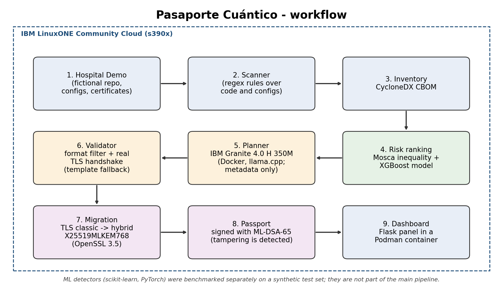

# Team MagIA Datathon 2026 Project: Pasaporte Cuántico

# Pasaporte Cuántico — Team MagIA_IBM Z Datathon 2026 Project

**Theme 2: AI Secured, Innovation Without Exposure**

Pasaporte Cuántico finds the vulnerable cryptography of an institution, ranks what to migrate first by how long its data must stay secret, tests every proposed fix automatically, migrates a service to hybrid post-quantum TLS and issues a readiness passport signed with ML-DSA. Everything runs on IBM LinuxONE (s390x).



## 1. The problem and the data behind it

Hospitals, civil registries and pension agencies protect records that must stay confidential for decades with RSA and elliptic-curve cryptography.

- **NIST IR 8547** (initial public draft, Nov 2024; still listed as a draft on NIST's publications page) proposes deprecating 112-bit public-key algorithms such as RSA-2048 after 2030 and disallowing all quantum-vulnerable public-key algorithms (RSA, ECC) after 2035. [NIST](https://csrc.nist.gov/pubs/ir/8547/ipd)
- **"Harvest now, decrypt later":** an adversary can store encrypted traffic or steal datasets today and decrypt them once quantum computers mature. [Cloudflare, Mar 2025](https://blog.cloudflare.com/post-quantum-zero-trust/)
- **Peru, Reniec (Apr 2024):** Reniec reported more than 4.6 million cyberattacks blocked since the start of 2024. These are blocked attempts, not a confirmed breach. [Canal N](https://canaln.pe/actualidad/reniec-bloqueo-46-millones-ciberataques-lo-que-va-2024-n472725)
- **Peru, Minsa (Aug 2022):** a security alert reported that data of about 44,000 Minsa patients was offered for sale on a deep-web forum. It was an offer for sale, and the article notes it was not known whether Minsa had reported it. [Gestión](https://gestion.pe/tendencias/en-la-mira-hacker-roba-base-de-datos-de-44-mil-pacientes-del-minsa-ciberseguridad-seguridad-digital-noticia/)

**Project question:** how can an institution without cryptography specialists find what it has, learn what is most at risk, and migrate it before 2030?

**Who benefits:** citizens whose long-lived records (health, identity, tax) are held by public institutions, and the IT teams of those institutions.

## 2. The solution

All steps run on a LinuxONE Community Cloud instance.

1. **Scanner:** regex rules find vulnerable cryptography in code and configuration of a fictional "Hospital Regional Demo".
2. **Inventory:** findings are exported as a CycloneDX CBOM.
3. **Risk ranking:** the Mosca inequality (data lifetime + migration time vs. years to a quantum threat) and an XGBoost model rank assets by urgency; every ranking line shows its reason.
4. **Planner:** IBM Granite 4.0 H 350M proposes post-quantum TLS groups for the quantum-vulnerable assets. It receives metadata only, never code or secrets.
5. **Validator:** every proposal must pass a format filter and a real TLS handshake; a template is the fallback.
6. **Migration:** a service moves from classical TLS to hybrid X25519MLKEM768 using OpenSSL 3.5.
7. **Passport:** a readiness passport is signed with ML-DSA-65; changing one character makes verification fail.
8. **Dashboard:** a Flask panel runs in a Podman container.

Two ML detectors (scikit-learn and PyTorch) were benchmarked separately on a synthetic test set. They are not part of the main pipeline.

## 3. How it uses IBM LinuxONE and open-source AI/ML

- **Platform:** a LinuxONE Community Cloud instance (s390x, Ubuntu). OpenSSL 3.5.0 was compiled on the instance to get native ML-KEM and ML-DSA.
- **Containers:** Podman runs the dashboard; Docker runs the lab image that hosts Granite and PyTorch.
- **AI/ML frameworks:** XGBoost (risk ranking), scikit-learn (detector), PyTorch 2.11.0, CPU build (detector, in the lab container), IBM Granite 4.0 H 350M served locally with llama.cpp.
- **Security:** post-quantum key exchange and signatures, plus a rule that AI output is never trusted without an automatic test.
- **Hardware:** the instance CPU exposes the `nnpa` flag in `lscpu`, and the lab container ships llama.cpp with a zDNN backend library. We did **not** benchmark hardware acceleration and make no claim about it.

## 4. Measured results

All numbers were measured on the instance. Timings that include starting the `openssl` process are for comparison only, not pure operation latency.

| What | Result |
|---|---|
| TLS 1.3 handshake, 50 attempts each | X25519: 6.4 ms, 50/50 OK. X25519MLKEM768: 6.5 ms, 50/50 OK |
| Signature, 100 repetitions (includes process start) | ECDSA P-256: 3.3 ms. ML-DSA-65: 5.0 ms |
| `openssl speed` | ECDSA P-256 about 64,000 signatures/s; RSA-2048 about 540 signatures/s |
| Passport | Original verifies; a one-character change is rejected |
| Granite proposals, prompt with 2 examples | 29/30 valid at first attempt, 30/30 after validation |
| Granite proposals, prompt without examples | 0/30 valid; all 30 fell back to the template |
| Detector on a synthetic test with unseen syntax (scikit-learn) | regex only: precision 1.00, recall 0.54. regex + ML: precision 0.62, recall 0.85 |
| Detector (PyTorch) | Same test set, 5 seeds; results in `evidence/torch_results.json` |
| Scanner on real open-source code | requests + paramiko: 107 files in 0.26 s (about 2.4 ms per file in this sample), 80 candidates |

**About the Granite experiment:** 3 assets x 10 repetitions x 3 candidates, one small base model. Without examples the model did not answer the question (it returned TLS versions and key sizes), so the format filter stopped those outputs before the TLS test. The TLS handshake is the second layer, and in the `planner/plan.py` demo it rejects a non-existent group. The two-sentence summary Granite writes restates the facts it is given; we do not present it as reasoning.

**About the real-code scan:** a manual review of 15 random candidates found 6 real uses in production code, 4 real uses only in tests, and 5 that are not uses (comments, docstrings, or tests checking that an algorithm is not used). That is a small sample. It shows that pattern matching is noisy on real code and misses different API names (for example, only 1 RSA use was detected in paramiko), which motivates the ML detector.

## 5. Limitations (transparency)

- The XGBoost model is trained on labels from expert rules over a synthetic inventory of 2,000 assets. Its high rank correlation (Spearman 0.98 on a synthetic hold-out) measures how well it copies the rules, not real risk. Next step: calibrate with real institutions and blind human labels.
- The detector benchmark is synthetic and the unseen test variants were written by the team. The ML raises recall at the cost of precision and flags false positives such as `import hashlib`, so it is proposed as a second filter with human review.
- Granite 4.0 H 350M is a small base model. It is only reliable on a guided task, and its output is checked by the validator.
- Z (years to a relevant quantum threat), data lifetimes and migration times are declared, configurable assumptions, not predictions.
- Passport levels (1 to 5) are criteria defined by our team. They are not a standard, a legal certification or a compliance statement.
- Scanner results on real repositories are candidates from pattern matching, not confirmed vulnerabilities.
- The "Hospital Regional Demo" is fictional. All risk-model data is synthetic because no public labeled quantum-risk dataset exists.

## 6. Evidence

The `evidence/` folder contains the workflow diagram, Granite proposals and validation results, the PyTorch detector results, the real-code scan output, and screenshots of the instance, containers, labs and benchmarks.

## 7. Run it

```bash
python3 scanner/scan.py lab/hospital_demo   # findings
python3 cbom/make_cbom.py                   # CycloneDX CBOM
python3 risk/mosca.py                       # rule-based ranking (Mosca inequality)
python3 ml/train_risk.py                    # XGBoost ranking
python3 planner/plan.py                     # template plan + TLS validator demo
bash passport/sign.sh                       # signed passport (ML-DSA-65)
python3 ml/detector.py                      # scikit-learn detector benchmark
bash demo.sh                                # runs the demo scenes in order
```

Granite planner (runs inside the lab container, the validator runs on the host):

```bash
cp ranking_ml.json planner/llm_propose.py ~/shared/
docker exec notebook /opt/venv/bin/python3 /home/ibm-user/shared/llm_propose.py
python3 planner/validate_llm.py
```

Dashboard in a container: `dashboard/Containerfile` (Podman). OpenSSL 3.5.0 is built from source into `~/openssl35`.

## 8. Team MagIA

| Member | Contribution |
|---|---|
| Yamile del Aguila | Team lead; overall architecture on LinuxONE, Granite planner and validator |
| Adriano Navarro | Scanner and ranking engine on LinuxONE |
| Geraldine Torres | TLS migration and signed passport |
| Bryan Huaytan | Dashboard and benchmarks |

## 9. Originality

All solution code was written during the hackathon (the commit history shows it). We ran the provided lab notebook (Loan Approval: predictive AI + generative AI with Granite on llama.cpp) to learn the platform. No lab code was copied into this repository, and our planner, validator and detectors are original.

## 10. Open-source resources and standards

- [OpenSSL](https://github.com/openssl/openssl) (ML-KEM, ML-DSA, hybrid TLS)
- [XGBoost](https://github.com/dmlc/xgboost), [scikit-learn](https://github.com/scikit-learn/scikit-learn), [PyTorch](https://github.com/pytorch/pytorch), [pandas](https://github.com/pandas-dev/pandas), [NumPy](https://github.com/numpy/numpy), [SciPy](https://github.com/scipy/scipy)
- [llama.cpp](https://github.com/ggml-org/llama.cpp), [llama-cpp-python](https://github.com/abetlen/llama-cpp-python), [IBM Granite](https://huggingface.co/ibm-granite)
- [Flask](https://github.com/pallets/flask), [Podman](https://github.com/containers/podman), [Docker](https://github.com/moby/moby)
- [CycloneDX CBOM](https://cyclonedx.org/capabilities/cbom/)
- NIST [FIPS 203](https://csrc.nist.gov/pubs/fips/203/final) (ML-KEM) and [FIPS 204](https://csrc.nist.gov/pubs/fips/204/final) (ML-DSA)
- Scanned as a real-world test: [requests](https://github.com/psf/requests), [paramiko](https://github.com/paramiko/paramiko)
- Datasets: public open-source repositories scanned as a real-world test (requests, paramiko); the risk model uses synthetic data because no public labeled quantum-risk dataset exists.

